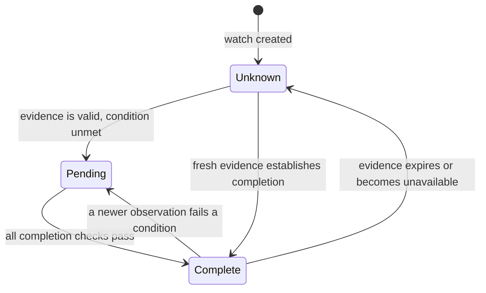

<h1 align="center">Ternela</h1>
<p align="center"><strong>Give agents a reliable way to wait.</strong></p>
<p align="center">Turn a task into evidence checks. Track what changes. Wake the agent with a receipt.</p>
<p align="center">
  <a href="LICENSE">Apache 2.0</a> ·
  <a href="#try-it">Try it</a> ·
  <a href="docs/architecture.md">Architecture</a> ·
  <a href="docs/evaluation.md">Evaluation</a>
</p>


## Why

An agent can understand “continue when this exact payment succeeds.” It still needs
to identify the right payment, inspect its amount and customer, recover missing
observations, and remember what it was waiting for across restarts.

Ternela makes that wait explicit: **a task, an observation plan, a current decision,
and a receipt explaining the evidence.** The runtime prepares observations once,
then commits them only after rechecking identity, ordering and freshness. Fresh observations can establish readiness
or completion. Missing, inaccessible or expired evidence stays unknown.

## Try it

**Supported host: macOS.** Windows and Linux hosts are unsupported for this first
alpha release. The Linux container is the application runtime.

**Local container install (recommended):** start Docker Desktop or Colima on
macOS. Clone this repository, then run the installer.
No host Python or provider account needed.

```sh
git clone https://github.com/Alphabetsoup16/ternela.git
cd ternela
sh scripts/ternela.sh install
```

The installer keeps
Ternela's host files in one folder, ask whether to enable automatic stable-release
updates (default **no**), use a local Docker volume for live data, and print the local workbench URL when healthy.

```sh
sh ~/ternela/ternela.sh update          # check and install a newer release now
sh ~/ternela/ternela.sh updates on      # opt in; use off to disable
sh ~/ternela/ternela.sh remove          # retain data; --purge deletes volume and folder
```

[Install, update recovery and removal →](docs/local-install.md)

**From Python source:**

Requires **Python 3.11+**, **curl**, and macOS. No Python dependencies or
provider credentials are needed for the bundled replay.

```sh
git clone https://github.com/Alphabetsoup16/ternela.git ternela
cd ternela
python3 -m ternela.setup_demo
python3 -m ternela.demo
```

```text
processing         -> pending
success            -> complete
evidence expired   -> unknown
3 durable decision changes; simulated provider responses; no model call.
```

Setup downloads and verifies pinned public API specifications. The replay then
runs locally without network calls or model inference.

For the interactive workbench:

```sh
python3 -m ternela
# Open http://127.0.0.1:8765
```

The workbench opens on a live GitHub Status check. Choose **Check now**, or use
**New watch** to check GitHub service status or an exact PyPI/npm package version.
The conditions behind each result are visible; plans and receipts are under
**Technical details**. **Saved watches** recovers waits from the service across
browsers; **Watch usage** shows reads, decision changes and unknown observations.

A named consumer can resume queued decisions after a process restart, then acknowledge
them after handling. [Try the complete handoff →](docs/product-runtime.md)

**Simulated demos** let you try a wrong quantity, an over-budget preview or an older
update without connecting an account. Compiling your own task is an advanced option
that requires a signed-in Codex CLI on `PATH` (not included in the container).
[Interface and maintenance guide →](docs/ui.md)

For an unattended public wait, select the GitHub, GitHub Status, PyPI or npm example and
**Start automatic checks**. The local service checks every five minutes for up to
24 hours; its schedule survives restart. You can pause it from the same view.
[Monitoring contract and SDK example →](docs/monitoring.md)

## What a watch does



Before-action checks use **ready / blocked**; after-action checks use
**complete / pending**. Both phases can be **unknown** or **unverifiable**.
A queue message records a historical transition. Read the current watch before
acting on it.

## Built for the awkward cases

- **Exact evidence.** Check identifiers, values and business phase—not just whether
  an event arrived. Traverse every required page before asserting completeness.
- **Preserved values.** Typed dependency guards can copy an observed quantity
  exactly into a simulated preview. Invalid evidence stops the dependent read.
- **Recoverable waits.** SQLite persists watch state and a transactional wake-up
  outbox. Event IDs deduplicate retries; older caller revisions cannot overwrite
  newer observations.
- **Inspectable decisions.** Receipts retain observations, read attempts, checks,
  timestamps, source references and the plan hash in verified gzip blobs.

## Current scope

**This is an alpha, single-host prototype.** The compiler and evidence runtime
work; a production connector service is still being built.

| Capability | Today |
|---|---|
| Task-to-plan compilation | Pinned API docs, bounded retrieval expansion, schema admission |
| Persistent watches | Duplicate protection, evidence expiry, durable outbox and acknowledgements |
| Live provider reads | GitHub repository GETs, GitHub Status readiness and exact PyPI/npm release metadata |
| Automatic public checks | Persisted schedules, leased attempts, pause/resume, deadlines and backoff |
| Local distribution | macOS container install, opt-in app updates and startup rollback |
| Stripe and Slack | Document-grounded plans and simulated replay |
| Authenticated connectors and verified webhooks | Planned |
| Distributed workers, callbacks and tenant isolation | Planned |

Public package recipes are deterministic and reviewed; arbitrary task compilation
currently supports GitHub, Stripe and Slack. [Status readiness](docs/status-readiness.md)
uses a separate reviewed recipe. Authenticated GitHub remains the next
full workflow. [Public connectors and account-free examples →](docs/public-connectors.md)
A receipt describes bounded evidence; it does not prove universal real-world truth
or make a later business action atomic with the observation.

## Evidence, not a headline benchmark

The current implementation passes **355 unit/API tests** and **41/41 known regression
scenarios**, with zero structural audit issues or false ready/complete outcomes in
that regression set. Those scenarios use simulated responses and previously seen
providers. They are not a blinded generalization or production reliability claim.

```sh
python3 -m ternela.check
python3 -m ternela.regression
```

[Read the evaluation and its limits →](docs/evaluation.md)

For development, `python3 -m ternela.check --watch` rechecks affected code and compares
bounded local receipt examples while you edit. Unchanged work reuses its successful
result; uncertain changes run the full suite. [How the loop stays small →](docs/development.md)

## Explore

[API and event contract](docs/api.md) · [Architecture](docs/architecture.md) ·
[Product plan](docs/roadmap.md) · [Add a connector](docs/adding-connectors.md) ·
[Optional Jev review](docs/semantic-review.md) ·
[Contributing](CONTRIBUTING.md) · [Rebranding](docs/rebranding.md) ·
[Release notes](docs/releases/v0.1.1.md) ·
[Release audit](docs/audits/2026-10-19.md) ·
[Monitoring audit](docs/audits/2026-10-19-monitoring.md) ·
[Public connector audit](docs/audits/2026-10-19-public-connectors.md) ·
[Connector contract audit](docs/audits/2026-10-19-connector-contracts.md) ·
[Status experiment](docs/audits/2026-10-19-github-status.md) · [Third-party notices](THIRD_PARTY_NOTICES.md)

Original code is licensed under [Apache 2.0](LICENSE). Downloaded provider materials
retain their upstream licenses and attribution.
