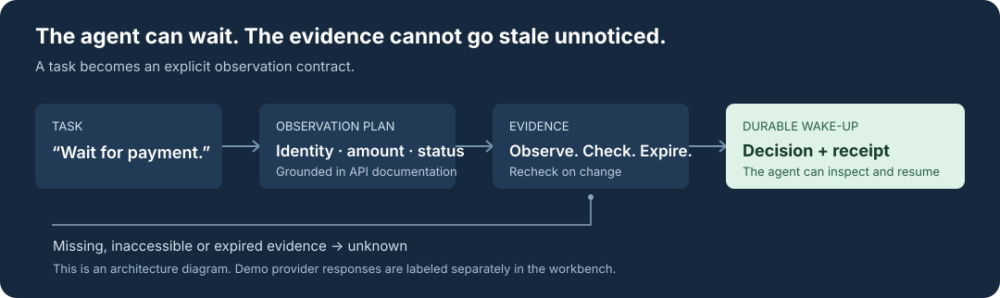
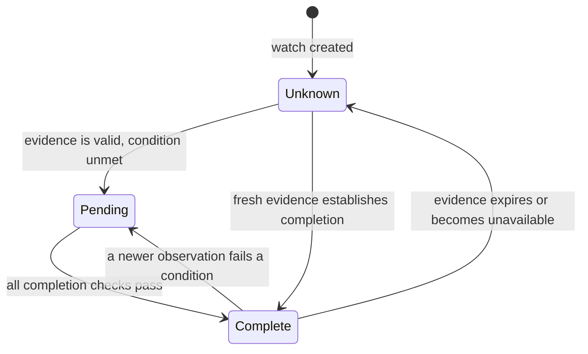

<h1 align="center">Thenwake</h1>
<p align="center"><strong>Give agents a reliable way to wait.</strong></p>
<p align="center">Turn a task into evidence checks. Track what changes. Wake the agent with a receipt.</p>
<p align="center">
  <a href="LICENSE">Apache 2.0</a> ·
  <a href="#try-it">Try it</a> ·
  <a href="docs/architecture.md">Architecture</a> ·
  <a href="docs/evaluation.md">Evaluation</a>
</p>



## Why

An agent can understand “continue when this exact payment succeeds.” It still needs
to identify the right payment, inspect its amount and customer, recover missing
observations, and remember what it was waiting for across restarts.

Thenwake makes that wait explicit: **a task, an observation plan, a current decision,
and a receipt explaining the evidence.** Fresh observations can establish readiness
or completion. Missing, inaccessible or expired evidence stays unknown.

## Try it

Requires **Python 3.11+**, **curl**, and macOS or Linux. No Python dependencies or
provider credentials are needed for the bundled replay.

```sh
git clone https://github.com/Alphabetsoup16/thenwake.git
cd thenwake
python3 -m thenwake.setup_demo
python3 -m thenwake.demo
```

```text
processing         -> pending
success            -> complete
evidence expired   -> unknown
3 durable decision changes; simulated provider responses; no model call.
```

Setup downloads and verifies pinned public API specifications. The replay then
runs locally without network calls or model inference.

For the interactive workbench:

```sh
python3 -m thenwake
# Open http://127.0.0.1:8765
```

Change a quantity to a string, exceed a preview budget, replay an older update,
or let evidence expire. Inspect the checks and receipts behind every decision.
The GitHub release example can perform a real public GET; other preset responses
are visibly simulated. Compiling your own task additionally requires a signed-in
Codex CLI on `PATH`.

## What a watch does



Before-action checks use **ready / blocked**; after-action checks use
**complete / pending**. Both phases can be **unknown** or **unverifiable**.
A queue message records a historical transition. Read the current watch before
acting on it.

## Built for the awkward cases

- **Exact evidence.** Check identifiers, values and business phase—not just whether
  an event arrived. Traverse every required page before asserting completeness.
- **Preserved values.** Typed dependency guards can copy an observed quantity
  exactly into a simulated preview. Invalid evidence stops the dependent read.
- **Recoverable waits.** SQLite persists watch state and a transactional wake-up
  outbox. Event IDs deduplicate retries; older caller revisions cannot overwrite
  newer observations.
- **Inspectable decisions.** Receipts retain observations, executed reads, checks,
  timestamps, source references and the plan hash in verified gzip blobs.

## Current scope

**This is an alpha, single-host prototype.** The compiler and evidence runtime
work; a production connector service is still being built.

| Capability | Today |
|---|---|
| Task-to-plan compilation | Pinned API docs, bounded retrieval expansion, schema admission |
| Persistent watches | Duplicate protection, evidence expiry, durable outbox and acknowledgements |
| Live provider reads | Bounded public GitHub repository GETs |
| Stripe and Slack | Document-grounded plans and simulated replay |
| Authenticated connectors and verified webhooks | Planned |
| Automatic provider polling, distributed workers and tenant isolation | Planned |

The next connector focus is GitHub, followed by generic event ingestion and Linear.
A receipt describes bounded evidence; it does not prove universal real-world truth
or make a later business action atomic with the observation.

## Evidence, not a headline benchmark

The current implementation passes **86 unit/API tests** and **41/41 known regression
scenarios**, with zero structural audit issues or false ready/complete outcomes in
that regression set. Those scenarios use simulated responses and previously seen
providers. They are not a blinded generalization or production reliability claim.

```sh
python3 -m thenwake.check
python3 -m thenwake.regression
```

[Read the evaluation and its limits →](docs/evaluation.md)

## Explore

[API and event contract](docs/api.md) · [Architecture](docs/architecture.md) ·
[Contributing](CONTRIBUTING.md) · [Third-party notices](THIRD_PARTY_NOTICES.md)

Original code is licensed under [Apache 2.0](LICENSE). Downloaded provider materials
retain their upstream licenses and attribution.
