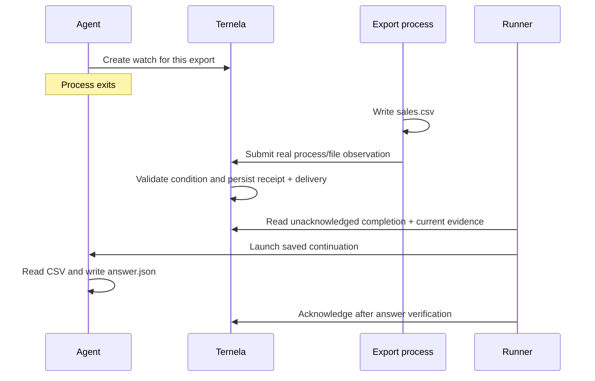

# Watch an agent leave and return

**Task:** “When the sales export is ready, summarize it.”

The initial agent creates a Ternela watch and exits. A separate local process writes
an actual CSV and submits a process/file observation. Ternela evaluates the exact job
identity, successful exit, artifact name, digest and row count. A small runner reads
its durable queue and launches the continuation only when current evidence is fresh
and complete. The continuation reads the CSV and writes a sales summary. The runner
checks that answer against the actual bytes before acknowledging the delivery.



## Click once in the workbench

Install or update to v0.1.2, open the printed workbench URL, and click
**Run agent demo** at the top. From a prepared source checkout, run
`python3 -m ternela` and open [the workbench](http://127.0.0.1:8765/).
The same example runs on the local server. The browser displays actual saved events:
watch created, agent stopped, export received, continuation launched, answer verified.
The export takes five seconds so the stopped state is easy to see. A reload rejoins
saved progress; another click while running reuses the active run.

This UI mode always uses the deterministic reference agent. It cannot launch Codex,
accept arbitrary commands or read a user-selected folder. The job, CSV, watch,
queue and continuation are real. **Inspect the actual output** shows the produced
CSV and verified answer. The runner polls the saved queue; no model runs during
that wait. Events can complete between browser refreshes, and their actual timestamps
remain visible in the timeline.

Runs are isolated under `data/demos/ui/`, with compressed logs. Starting another run
retains up to five previous finished runs plus the current run; older owned finished
runs are removed. Unrelated folders and active runs are retained. A running server
bounds each attempt to 45 seconds. A stalled/interrupted attempt fails visibly and
can be retried. The latest saved completion remains inspectable after restart.
POST uses the existing local token and origin checks. This is a local alpha demo,
not an endpoint for remotely scheduling arbitrary agents.

## See the handoff without an account

From the current source checkout, with Docker Desktop or Colima running on macOS:

```sh
sh scripts/agent-demo.sh
```

No host Python or model account is required. The first run builds a local image and
needs network access for its pinned base and API source seeds. The demo itself runs
with networking disabled, without a Docker socket or host-home mount. It uses native
container storage in its own temporary anonymous volume, then copies the artifacts into
`data/demos/container-ID/` and removes its own container and volume. Its single local demo image
can be reused on later runs. The existing Ternela service and saved watches are untouched.

**This mode uses a deterministic reference agent, not an LLM.** The export process,
CSV, watch admission, evidence evaluation, queue, continuation process and
acknowledgement are real. It is not a replay of invented payment or GitHub events.

From Python source, the same reference flow is:

```sh
python3 -m ternela.setup_demo  # once, to verify source seeds used by admission
python3 -m examples.agent_handoff
```

Example output:

```text
AGENT     Summarize the export when ready (reference agent; no model call).
WATCH     Saved … · pending. Initial agent process exited.
JOB       Separate export process started. Agent is not running during this wait.
PENDING   Condition not complete; agent stays stopped.
RESUME    Completion received. Launching the saved agent continuation.
DONE      3 orders · $68.00 USD. Answer verified; delivery acknowledged.
```

The UI and CLI demos are included in the v0.1.2 application archive. Existing
v0.1.1 installations receive them through their ordinary update command.

## Use a real model-backed agent

With Python 3.11+ and an installed, signed-in Codex CLI:

```sh
python3 -m examples.agent_handoff --agent codex
```

This makes two bounded model turns using the CLI's existing login and configured
model. The first turn must call `tools.py watch` and finish before the export starts.
The runner saves the returned session UUID. After a valid completion it calls
`codex exec resume UUID`, so the same conversation continues; it does not select
an unrelated `--last` session. The resumed agent inspects current evidence, reads
`sales.csv`, calculates the total and writes `answer.json` itself.

The CLI uses a workspace-write sandbox for the demo folder. This is a cooperative
example, not a security boundary against a malicious agent. No credentials are
copied into Docker. Model calls may consume your account's usage. Missing CLI,
failed model turns, invalid output or an unexpected session ID fail visibly; the
runner never silently substitutes the reference agent.
[Official Codex non-interactive/session documentation](https://learn.chatgpt.com/docs/non-interactive-mode).

## Prove the runner can leave too

```sh
python3 -m examples.agent_handoff --dir ./data/demos/recovery-example --detach
# The bounded export keeps running, but no agent is invoked while the runner is gone.
python3 -m examples.agent_handoff resume --dir ./data/demos/recovery-example
```

The initial directory must not already exist. Use a new name for another run.
Resume works with either agent mode using its saved configuration. It requires no
second human approval of the original task. Evidence expires after five minutes;
an old completion does not authorize a new continuation. Start a new demo if the
saved evidence has expired. The ordinary wait is bounded, defaulting to 120 seconds;
the independent producer delay is bounded to 30 seconds.

Try a failed job:

```sh
python3 -m examples.agent_handoff --fail-job --delay 1
```

It exits with an error and does not resume the agent. A failed export can leave the
business condition pending without changing its decision. The runner therefore
also inspects current saved evidence to report this failure promptly; absence of a
new outbox entry is not proof the producer is healthy.

## Inspect what happened

Every run prints its folder. It contains:

- `sales.csv`: the actual producer output; three orders totaling 6,800 cents.
- `answer.json`: verified continuation output, bound to the artifact digest and
  `watch_id:message_id` delivery key.
- `completed.json`: the local result ledger used to recover acknowledgement.
- `data/watches.sqlite3` and `data/blobs/`: ordinary Ternela watch, outbox, consumer
  and compressed evidence storage.
- `timeline.jsonl.gz` and compressed agent logs. Model mode retains its CLI session
  ID and compressed JSON events; normal Codex session storage remains CLI-managed.

The local answer is checked before its ledger is saved, and the ledger is saved
before acknowledgement. If the runner stops between those steps, resumption can
acknowledge the valid saved answer without another model invocation. A file lock
prevents two demo controllers from launching the same continuation simultaneously.
This only covers this bounded local output; arbitrary external actions still need
their own idempotency and recovery behavior. Observation and later action remain
non-atomic. At-least-once delivery is not exactly-once execution.

## Observation contract

`examples/handoff_support.py` declares a small local evidence-view schema and a
reviewed data-only plan. The producer submits caller-observed facts through the
same `Watches.create/submit` runtime used by the workbench. `GET /jobs/{job_id}` names
the local read contract; it is not an HTTP endpoint. The schema provenance explicitly
identifies this demo. No public connector, webhook ingress, general filesystem
watcher or authenticated service was added. The production monitor and its public
origin restrictions are unchanged.

This establishes the handoff for a controlled local job. It does not establish
independent truth of arbitrary producer reports, automatic task compilation or a
production agent scheduling service.
