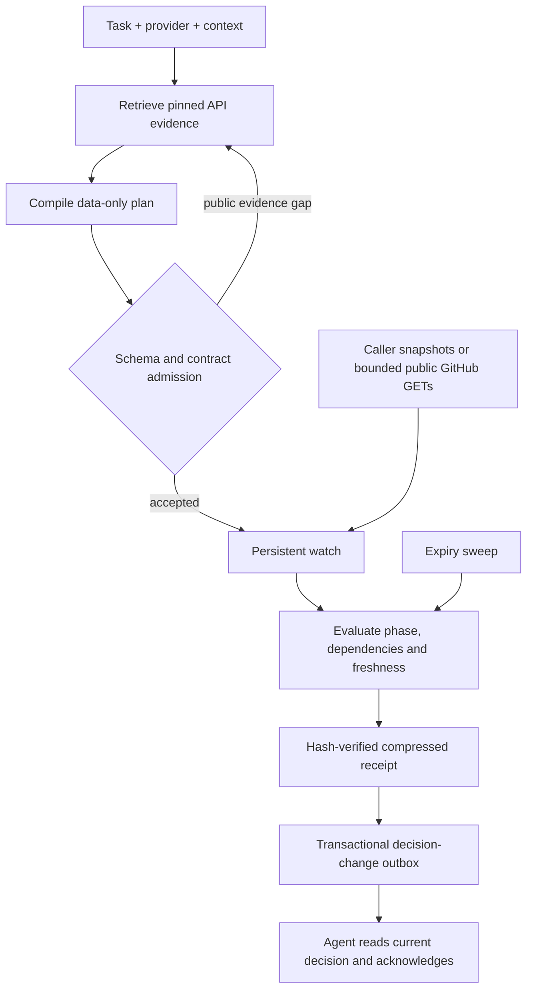

# Architecture

Ternela separates interpretation from evaluation. A model helps construct a
data-only observation plan; ordinary code evaluates captured evidence against it.

## Planning

The compiler discovers operations in pinned specifications, reads relevant schema
branches and expands retrieval on explicit evidence gaps. Its output is JSON data,
not executable code. Compilation and watch creation share admission rules. A plan rejected at admission
is retained as a failed run and is not offered as a completed task.

The current inference backend is a signed-in Codex CLI with
tools, web and apps disabled. Private scenario expectations do not enter inference.

The supplied context binds exact resource identifiers and thresholds. The
compiler's proposed poll interval does not start a polling schedule.

## Evaluation

Admission checks documented operations and fields, JSON expressions, requirement
coverage, business phases and typed preservation guards. The evaluator executes
only a phase's observations and their dependencies. Collections need explicit
pagination completeness. Failed observations and type/identity guard failures
produce unknown, rather than silently reusing an earlier success.

The runtime's existing-item Stripe price-preview policy is explicit domain policy.
It has not been automatically derived as a universal business rule. A preview's
typed copy preserves an observed quantity without making concurrent provider
changes atomic.

## Persistence

Watch metadata, deduplication keys and wake-up references live in SQLite. A receipt
and its changed-decision outbox entry are committed in the same database
transaction. Full payloads live in immutable SHA-256-addressed gzip blobs, flushed to disk and atomically published
before that transaction refers to them. A crash can leave an unreferenced blob;
it cannot make the database reference a receipt that has not been written.

The expiry sweep uses an indexed deadline query. It invalidates evidence and
persists an unknown decision after the watch's freshness window.

## Code map

| Package | Responsibility |
|---|---|
| `ternela/` | Public entry points, shared admission, branding, setup and checks |
| `workbench/` | Local service, event-fed watches, SDK and interface |
| `source_lab/` | Separately attributed documentation supplements |
| `safety_lab/` | Phase and preservation validation |
| `expansion_lab/` | Retrieval expansion, inference provenance and compressed storage |
| `docs_lab/`, `observation_lab/` | Shared schema, pagination, audit and comparison primitives |

Package names ending in `_lab` preserve the experiment's implementation lineage.
The `ternela` entry points are the public starting point. This release runs from
a source checkout; no PyPI distribution has been published.

Authenticated provider scheduling, webhook verification, distributed delivery and
multi-tenant authorization are future service layers. Current event ordering is
a caller-managed revision sequence for one watch, not a cross-provider causal clock.

Display branding is isolated from stable import and storage names. See
[rebranding](rebranding.md). Source checkout or editable installation is supported;
standalone wheel installation has not been validated.
