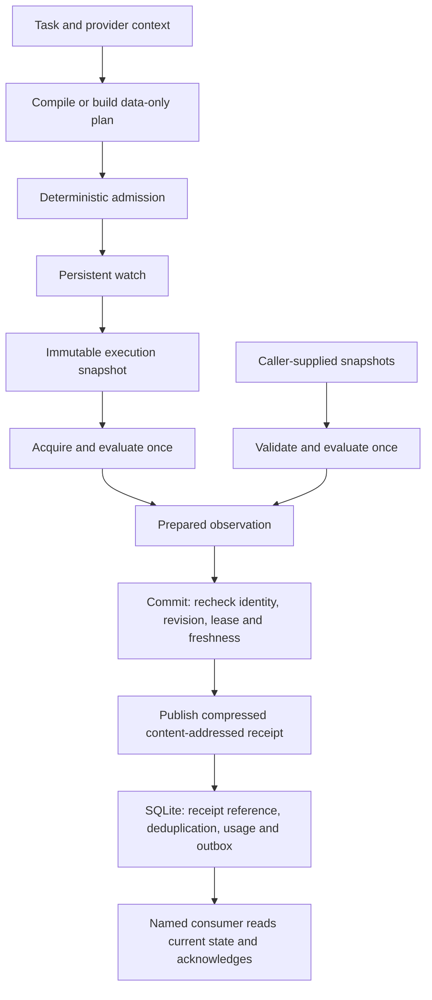

# Architecture

Ternela separates model-assisted interpretation, deterministic observation and
transactional persistence. The stable runtime lives under `ternela/`; the local
HTTP/UI workbench and historical experiments depend on that runtime.

## Ownership

| Module | Owns |
| --- | --- |
| `ternela.client` | Standard-library local HTTP SDK; `ternela.Client` is its public alias. |
| `ternela.watches` | Admission, preparation and public watch projections. No SQL. |
| `ternela.observations`, `evaluation`, `guards` | Phase/dependency execution, pagination, typed comparison and preservation. |
| `ternela.acquisition`, `connectors`, `providers/` | Bounded public acquisition and reviewed provider interpretation. |
| `ternela.monitor` | Polling, backoff and deadline policy. No SQL. |
| `ternela.repository` | Watch/event persistence, receipt/outbox atomicity, directory, usage and consumer checkpoints. |
| `ternela.schedules` | Persisted schedule configuration, exclusive claims and provider deferrals. |
| `ternela.database`, `migrations` | Shared connection/transaction boundary and ordered SQLite upgrades. |
| `ternela.contracts`, `errors` | Immutable internal handoffs, typed references/decisions/receipts and specific domain failures. |
| `ternela.paths` | Installed assets and one writable data root; source overrides preserve verification. |
| `ternela.storage` | Canonical JSON, hash verification and atomically published gzip blobs. |
| `ternela.schema`, `plan_schema`, `plan_audit`, `validation` | The current strict schema and admission contract. |
| `ternela.specification`, `pinned_sources`, `sources` | Pinned API specifications and separately attributed documentation supplements. |
| `ternela.compiler/` | Saved-task compilation, bounded evidence expansion, inference provenance, guides and canonical prompts. Uses shared plan schemas and admission. |
| `workbench/` | Local HTTP service, interface, compiler process orchestration and bundled demonstrations. |
| `*_lab/` | Historical evaluators/schemas/fixtures and compatibility imports for moved implementations. |

The ordinary check command follows transitive imports from the SDK, watch service
and monitor, plus the active compiler. Stable runtime/compiler code cannot depend on the workbench or experiment
packages. Provider modules cannot import scheduling, persistence or direct network
clients. These source rules support review; they do not sandbox trusted Python.

## Prepare and commit

`Watches.snapshot(id)` captures the watch's task, plan, phase, TTL and content
references without UI projections. Its JSON tree and reference mappings are
immutable. The monitor reuses this snapshot through acquisition and preparation,
avoiding a second database read. A snapshot is an input, not a reservation.

`acquire(...)` executes dependencies, preservation guards and pagination, then
evaluates once and returns an immutable `Acquisition`. It carries a hash binding the
full plan, context and business phase, plus the observation time. `Watches.prepare`
accepts it only for the same binding and time. Caller snapshots instead pass through
the same evaluator during preparation. Frozen JSON is validated on entry; subsequent
reads copy containers while reusing immutable scalar values. Encoding is deferred
until bytes or a content hash are needed.

`Watches.commit` accepts an in-process `PreparedObservation`, never serialized
caller decision JSON. The HTTP event endpoint still accepts observation snapshots,
not prepared conclusions. These Python objects are trusted internal contracts, not
cryptographic capabilities or a sandbox against hostile code in the process.

Evaluation and network I/O happen outside SQLite's write transaction. Commit checks
current plan/task hashes, phase, ordered revision/source time, and the monitor's
lease token, enablement and deadline. It rechecks the lease after blob publication,
and expiry during a slow write becomes unknown. Pause, changed configuration,
replacement claims and newer observations therefore still fence stale work.
`submit` remains the backwards-compatible prepare/commit convenience method.

The separate commits of a caller/provider observation and a business action are
not atomic. An agent must reread current status and make external actions idempotent.

## Persistence and versions

Small state and references live in one SQLite database. Receipt data is flushed and
atomically published as a SHA-256-addressed gzip blob before the database points to
it. Receipt selection, event deduplication, accepted-observation counters and changed
decision outbox insertion share one transaction. A crash can leave an unreferenced
blob; retention/garbage collection remains separate work.

Database upgrades run in ordered transactions with `PRAGMA user_version` and a
`schema_migrations` history. Existing unversioned databases upgrade in place. Applied
migration history is checked and never silently repaired; unsupported newer schemas
are rejected before journal/table changes. A failed upgrade rolls back DDL and
version changes. Add a new migration for future schema changes rather than editing
an applied step.

New watch plan/receipt references declare `record_type` and `record_version: 1`.
The underlying JSON and its content hash stay compatible with existing blob readers.
Unversioned references are legacy v0; they are read without rewriting historical
blobs. Unknown explicit kinds/versions are rejected before interpretation.
`GET /api/health` exposes supported format versions. These format versions are
separate from the application's release version and the historical experiment names.

Named consumers keep independent ordered checkpoints. Delivery is at least once;
acknowledge after processing. Acquisition counters are diagnostic: collection occurs
outside the receipt transaction, so a crash before its accounting write can undercount.

## Extension and compatibility

A provider owns its reviewed origin, operation/parameter rules, deterministic
normalization, evidence-view schema, limitations and optional recipe/descriptor.
Scheduling, freshness, evaluation and delivery remain shared. The frontend builds
recipe fields from descriptors rather than a duplicate catalog.

`workbench.engine`, `client`, `live`, `monitor` and moved source/storage/evaluation
modules remain aliases to their canonical implementation. Existing import identities
and mock seams stay intact. The legacy `collect` tuple API is retained; production
monitoring, refresh and updater paths use `acquire` to retain prepared observations.
The active compiler lives entirely in `ternela.compiler`: `jobs` starts a saved
local task, `run` orchestrates its stages, `evidence`/`retrieval`/`feedback` manage
bounded public evidence, and `inference` records the CLI interaction. `guides` and
`prompts/` hold its source inputs. Compiler plans use `ternela.plan_schema` and final
admission uses `ternela.validation`; neither contract is reconstructed in a lab.

`python -m ternela.compiler JOB_ID` is the product subprocess entry point. The old
`workbench.compiler`, expansion runner/inference/evidence, hardened feedback, guides
and retrieval imports alias the same module objects, preserving patches as well as
import identities. Historical research evaluators and older schema versions retain
their intentional differences. The source-only experiment runner's default regression
fixture location remains supported; normal saved-task compilation supplies its own
data directory and does not read historical fixtures.

New code snapshots identify canonical `ternela/` code and prompts rather than
unrelated interface/lab source. Previous manifests, blobs and lock files are retained;
a changed code manifest fails an old explicit lock rather than rewriting it.

Compilation still uses pinned documentation and a signed-in Codex CLI with tools,
web and apps disabled. Private expectations never enter inference. The compiler's
suggested interval does not automatically start monitoring. Stable SDK/runtime
imports do not require model access, the workbench or experiment packages.

This remains a single-host local product with reviewed anonymous connectors.
Authenticated sharing needs authorization-scope isolation; multi-provider causality,
distributed workers, webhook verification and multi-tenant authorization remain
future designs. Source checkout, the macOS Docker install and the locally built Python wheel are
validated paths. The wheel includes the UI, canonical compiler and legacy import adapters;
core imports still do not depend on them. Native Windows operation remains unsupported.
See [Python package installation and its validation limits](python-package.md).
