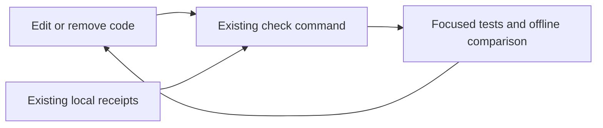

# Develop on one track

The product's intended job is to watch an external condition, maintain the evidence
behind its decision, and deliver a useful decision change to an agent. New work
should extend that path before inventing another execution mechanism.

The development loop uses the checks and receipts already present in this project:

```sh
python3 -m ternela.check --watch
```

Keep that command in a foreground terminal while editing. It checks at most once per
change, coalesces edits while a run is active, and stays idle between changes. Ctrl-C
stops it. It installs no daemon, makes no provider/model requests, and adds no approval
step. A single incremental pass is `python3 -m ternela.check --changed`. The original
`python3 -m ternela.check` always runs the full suite.



## Make the ordinary path the shared path

| Responsibility | Owner |
|---|---|
| Provider identity, approved operations, normalization and recipe | `ternela/providers/` |
| Origin/HTTP policy and acquisition boundary | `ternela/connectors.py`, `ternela/transport.py` |
| Phase, dependencies, preservation and decisions | Shared admission/evaluation runtime |
| Schedule, freshness, persistence and delivery | Watch/monitor runtime |
| Development selection and evidence reuse | Existing `ternela.check`, small `ternela.replay` helper |

A cheap AST source rule catches provider imports of the workbench runtime, common
schedulers and direct network clients. It also catches explicit dynamic provider
imports. A connector stays a connector; a second scheduler does not become the
normal way to add one. These rules detect common ownership violations, not arbitrary
Python behavior or indirect I/O. They are not a sandbox.

Runtime-dependency changes are reported and select full tests. They do not trigger
a separate permission/approval system. No code is automatically deleted and no
finite test result establishes that recovery logic is unnecessary.

## Spend work in proportion to the change

The checker fingerprints shipped source/assets, configuration, tests and pinned
source inputs. A local import graph includes transitive and relative imports, package
initializers, and literal module/mock targets. It selects dependent test files when
an existing Python file changes. New/deleted files, fixtures, assets, configuration,
unmapped changes and detected dynamic loading fall back to the full suite.

This is a conservative development accelerator, not a complete Python dependency
analysis. Browser interaction is still needed for UI behavior; Python tests do not
certify the interface. Restart the foreground watcher after changing the checker or
source-layout/watch rules themselves. Full checks remain appropriate for releases,
shared runtime refactors and uncertain changes.

A failed run never advances its successful source baseline. Source hashes and file
identities/timestamps are compared again at the end; detected edits or replacements
prevent recording a pass. This start/end comparison is not an immutable checkout
or an attestation against a writer that deliberately restores all observed metadata. The watcher checks
new edits next, without accumulating concurrent test jobs. Checks run in fresh
processes with fresh bytecode-cache locations, so same-size/same-timestamp edits
cannot silently exercise old imported code.

An unchanged source tree, Python environment identity and receipt-corpus digest can
reuse their successful results. The report distinguishes cached from replayed cases.
New receipt rows are still harvested incrementally. The default full command bypasses
that replay cache. The current application has no third-party runtime dependencies;
this cache does not fingerprint every externally installed distribution.

## Use activity as evidence

Accepted event receipts are read from local SQLite in read-only mode. Acquisition,
commit, monitoring and the UI gain no new runtime hooks. For a different local data
root, use `--data /absolute/path/to/data`; it must contain its `blobs/` and
`workbench/watches.sqlite3` together. The checker keeps its own derived files under
that data root's `checks/` directory:

- `baseline.json`: the last successful source/environment/corpus fingerprints.
- `receipts.json.gz`: bounded examples and the incremental event cursor.
- `last-run.json`: the current selection, outcomes, exclusions and elapsed time.

Public examples replay recorded **raw provider JSON** through the current connector,
normalization, schema validation and evaluator, using an injected offline reader.
Request bindings, continuation URLs and page consumption are compared too. Caller
snapshots use the same phase/dependency/preservation runtime. Exact Python integers
remain exact. Source payloads are not independently authenticated by this process.

Expected results come from the original receipt, not from running the new code.
This detects behavior changes; it does not establish that the old result was correct.
Curated negative connector fixtures and expiry/restart/delivery tests remain the
independent expectations for their authored scenarios. Freshness-only receipts and
unreplayable or oversized inputs are excluded explicitly; replay does not measure
current provider availability or delivery guarantees.

Before pruning any examples after a code change, replay the retained expectations.
A failing example prevents harvesting/eviction from erasing that disagreement. For
an intentional semantic change, add a separately justified regression expectation
and inspect the disagreement; historical examples must not silently relabel themselves.
The derived corpus can be rebuilt deliberately from retained original receipts. Such
a rebuild is not an endorsement of changed semantics.

Retention is deterministic and diverse across provider/outcome groups: at most 64
cases, 12 per provider, 256 KiB per case and 4 MiB of expanded corpus. Payload shapes
retain zero, negative/large integer, boolean, empty-string and list distinctions.
Repeated timing/event IDs do not create new examples. These heuristics are bounded
sampling, not exhaustive coverage; exclusions and evictions are reported. Up to 256
event rows are scanned per cycle, and a watcher drains remaining batches.

Original receipts are never removed. Harvested payloads stay in ignored local data;
they are not automatically promoted to public fixtures, shipped in release bundles,
or uploaded. Keep this derivative data under the same access/retention policy as
its originals. Missing/corrupt/oversized records remain visible in cumulative
exclusion counts instead of being mistaken for exercised coverage.

## Exercise subtraction

Remove or consolidate one mechanism, keep its expected outcomes fixed, and let the
same loop run. A successful comparison supports that edit within the exercised cases;
it does not prove the mechanism was universally redundant. Prefer removing repeated
ownership and execution paths over deleting rare recovery behavior because it was
not observed recently. A small implementation with wrong outcomes has not improved.


## Maintain the runtime boundaries

Stable client, acquisition, evaluation, watch, storage and scheduling code lives in
`ternela/`. Interface and experiment modules depend on it; compatibility files alias
the implementation rather than copying it. The existing check follows core imports
transitively to reject dependencies back into `workbench` or `*_lab`. Provider
ownership checks also reject imports of the new runtime scheduling/persistence modules.

Use immutable `Acquisition`, `WatchSnapshot`, `PreparedObservation` and `LeaseFence`
objects at internal boundaries. Keep HTTP inputs as validated data-only observations.
Preparation may reuse a content-checked snapshot, but commit must still verify current
identity, revision, phase, lease/deadline and freshness. Do not move evaluation into
the SQLite write transaction or turn a cached acquisition into an authority token.

Add a new ordered database migration for a schema change, and a new explicit record
version for an incompatible stored plan/receipt change. Test old data, failed upgrades,
unknown future versions and restart recovery. Historical blobs and semantic fixtures
remain unchanged by an implementation refactor.
